# 💰 Treinamento Prático de N8N: Construindo um Bot & Agente Financeiro do Zero

> **Do Conceito à Prática:** Este treinamento condensa **100% do conteúdo prático** dos módulos avançados da trilha **Santander Automação com N8N (DIO)** — *Manipulação de Dados e Variáveis*, *Automatizando Processos com N8N* e *Uso de Webhooks e APIs no N8N* — aplicado diretamente na construção de um **Agente Financeiro para Organização, Lançamentos e Alertas de Contas**.

---

## 📂 Estrutura do Repositório

| Arquivo / Pasta | Descrição |
| :--- | :--- |
| [`README.md`](./README.md) | **Treinamento Completo Passo a Passo** (teoria + prática mão na massa do Agente Financeiro). |
| [`workflows/agente-financeiro-n8n.json`](./workflows/agente-financeiro-n8n.json) | **Workflow pronto para importar no N8N** contendo os 2 fluxos completos (Bot via Webhook Autenticado + Automação Diária de Contas a Vencer) e dados pinados para teste imediato. |
| [`docs/GUIA-EXERCICIOS-E-QUESTOES-DIO.md`](./docs/GUIA-EXERCICIOS-E-QUESTOES-DIO.md) | **Caderno de Revisão Comentado** com todas as questões dos 3 cursos da DIO e a explicação técnica detalhada de cada resposta. |
| [`exemplos/testar-webhook.ps1`](./exemplos/testar-webhook.ps1) | **Script PowerShell** pronto para disparar requisições POST autenticadas contra o seu Agente Financeiro no n8n. |

---

## 🗺️ Visão Geral da Arquitetura do Agente Financeiro

O nosso projeto une exatamente os **dois mundos práticos** ensinados na trilha:

1. **Fluxo 1 — Chatbot Financeiro em Tempo Real (Curso 3: Webhooks, APIs e Segurança):**
   Recebe comandos via **Webhook POST autenticado** (de um WhatsApp/Telegram/App), limpa e converte os dados com expressões JavaScript/Luxon, roteia pelo menu interativo (`Switch`), valida valores (`Filter`), salva na planilha financeira (`Google Sheets` via OAuth2 com `Retry on Fail`) e devolve a resposta formatada.
2. **Fluxo 2 — Régua Automática de Contas a Vencer & Relatório HTML (Cursos 1 e 2: Processos, Merge, Loops e Agregação):**

```mermaid
flowchart TD
    subgraph Fluxo1["🤖 Fluxo 1: Bot Financeiro em Tempo Real (Webhook Autenticado)"]
        W["Webhook POST /bot-financeiro\n(Header Auth Bearer + IP Whitelist)"] --> SET1["Edit Fields (Set)\nLimpar Moeda/Telefone + Converter Tipos + Luxon"]
        SET1 --> SW["Switch (Menu do Bot)\n1: Registrar | 2: Resumo | 3: Menu"]
        SW -->|"Opção 1"| FIL1["Filter\nvalorNumerico > 0"]
        FIL1 --> GS["Google Sheets (OAuth2)\nSalvar Lançamento (Retry 5x / 5s)"]
        GS --> RESP1["Respond to Webhook\nConfirmação JSON (200 OK)"]
        SW -->|"Opção 2 ou 3"| RESP2["Respond to Webhook\nExibir Menu / Resumo"]
    end

    subgraph Fluxo2["📊 Fluxo 2: Régua Diária de Vencimentos & Relatório HTML"]
        CRON["Schedule Trigger\nTodo dia às 08:00"] --> API_COB["HTTP Request GET\nBuscar Cobranças (dueDate <= Hoje+3d)"]
        CRON --> API_CLI["HTTP Request GET\nBuscar Clientes/Responsáveis"]
        API_COB --> SO1["Split Out (campo: data)"]
        API_CLI --> SO2["Split Out (campo: data)"]
        SO1 --> MERGE["Merge (Combine by Fields)\ncustomer == id"]
        SO2 --> MERGE
        MERGE --> FIL2["Filter\nbillingType != 'CREDIT_CARD'\n(Somente Boleto e Pix)"]
        FIL2 --> LOOP["Loop Over Items\n(Processar Sequencialmente)"]
        LOOP -->|"loop"| HTML["Edit Fields (Set)\nTemplate HTML (strong, br)"]
        HTML --> EMAIL["Send Email\nSubject Dinâmico + Retry 5x"]
        EMAIL --> WAIT["Wait (3s)\nEvitar Rate Limit / Spam"]
        WAIT --> LOOP
        LOOP -->|"done"| AGG["Aggregate\nJuntar Itens em 1 Array"]
        AGG --> JOIN["Edit Fields (Set)\nResumo com .join('<br>')"]
    end
```

   Roda todo dia às 08h (`Schedule Trigger`), consulta faturas/contas e clientes em paralelo via `HTTP Request`, desempacota os arrays com `Split Out`, cruza os dados pelo ID com `Merge`, filtra apenas pagamentos via **Boleto ou Pix** que vencem nos próximos dias (`Filter`), envia alertas personalizados um a um com `Loop Over Items` + `Wait` e gera um relatório consolidado em HTML usando `Aggregate` + `.join('<br>')`.



---

## 📘 Módulo 1: Manipulação de Dados, Variáveis e Expressões (O que você perdeu no Curso 1)

Quando um dado chega ao n8n (seja de uma mensagem no WhatsApp, de um formulário ou de uma API bancária), ele quase nunca vem "limpo". Veja as 4 técnicas essenciais ensinadas nas aulas práticas:

### 1.1. Limpeza de Strings com Expressões Geradas por IA (Regex)
Quando o usuário manda no bot `"Gastei R$ 149,90"` ou informa o telefone `"(11) 99876-5432"`, precisamos limpar o texto antes de salvar ou chamar uma API:

- **Limpar telefone (manter apenas dígitos):**
  ```javascript
  {{ $json.body.telefone.toString().replace(/\D/g, '') }}
  // Entrada: "(11) 99876-5432" -> Saída: "11998765432"
  ```
- **Por que usar IA para gerar expressões no n8n?**
  Em vez de decorar expressões regulares (Regex) complexas, você pode pedir ao assistente de IA (ou no próprio recurso de IA do n8n) para gerar a expressão: é mais rápido e reduz drasticamente erros de sintaxe.

### 1.2. Conversão Explícita de Tipos (`.toNumber()`, `.toString()`, `.toDateTime()`)
Um dos erros mais comuns em automações financeiras é tentar somar valores ou formatar datas que chegaram como texto (`string`):
- **Regra de ouro do n8n:** Uma `string` que parece uma data (ex.: `"2026-10-30"`) **não aceita funções de data** até ser convertida com `.toDateTime()`!
- Da mesma forma, se uma API espera um número no campo `number` e recebe letras, ela pode estourar **Erro 500**; se espera `string` e recebe `number`, convertemos com `.toString()`.
- **Vantagem:** A conversão de tipos no n8n normaliza os dados no meio do caminho **sem exigir nenhuma alteração no sistema de origem**.

```javascript
// Converter texto monetário "R$ 149,90" em Number real (149.9):
{{ $json.body.valor.toString().replace(/[^0-9,.-]/g, '').replace(',', '.').toNumber() }}

// Forçar número para String quando a API exigir:
{{ $json.valorNumerico.toString() }}
```

### 1.3. Manipulação de Datas Financeiras com Luxon (`$now`, `plus`, `minus`, `toFormat`)
O n8n utiliza a biblioteca **Luxon** nativamente para trabalhar com datas:
- **Data e hora atual:** `{{ $now }}`
- **Somar ou subtrair tempo (`plus` e `minus`):**
  ```javascript
  // Buscar contas que vencem nos próximos 3 dias:
  {{ $now.plus({ days: 3 }).toFormat('yyyy-MM-dd') }}

  // Buscar extrato dos últimos 30 dias:
  {{ $now.minus({ days: 30 }).toFormat('yyyy-MM-dd') }}
  ```
- **Extrair apenas o Mês (2 dígitos):**
  Usa-se **`MM` (dois M maiúsculos)** — *atenção: `mm` minúsculo significa minutos!*
  ```javascript
  {{ $now.toFormat('MM') }} // Retorna "10" para Outubro
  ```
- **Gerar um ID/Protocolo Aleatório (`Math.random()`):**
  `Math.random()` retorna um decimal aleatório entre `0` e `1`. Multiplicando por `1000000`, criamos um ID único para cada lançamento:
  ```javascript
  {{ 'FIN-' + Math.floor(Math.random() * 1000000).toString() }}
  ```

### 1.4. `Aggregate` + `.join('<br>')` + Templates HTML para Relatórios
Imagine que o seu filtro encontrou **5 contas vencendo hoje**.
- Se você ligar um nó `Send Email` direto após o filtro, o n8n executará o nó **5 vezes** (enviando 5 e-mails separados!).
- **Como enviar 1 único e-mail com a lista das 5 contas?**
  1. Use o nó **`Aggregate`** antes: ele junta os 5 itens separados em **1 único array** (`lancamentosAgregados`).
  2. No nó **`Edit Fields (Set)`**, monte um template em **HTML** usando `.join('<br>')`:
     ```javascript
     {{
       '<h2>📊 Relatório Diário de Contas a Vencer</h2><br>' +
       $json.lancamentosAgregados
         .map(item => '• <strong>' + item.name + '</strong>: R$ ' + item.value + ' - Vence em: ' + item.dueDate)
         .join('<br>')
     }}
     ```
  > ⚠️ **Pegadinha clássica da prova e da vida real:** Nunca use `\n` no `.join('\n')` para e-mails em HTML! Clientes de e-mail ignoram `\n` e deixam tudo grudado na mesma linha. Use sempre tags HTML como `<strong>` (negrito) e `<br>` (quebra de linha).

---

## ⚙️ Módulo 2: Workflows Complexos, `Split Out`, `Merge` e `Loops` (O que você perdeu no Curso 2)

No segundo curso, o foco foi sair de **workflows simples** (lineares, poucas etapas, sem ramificação) para **workflows complexos** (múltiplas fontes de dados, cruzamento relacional e disparo controlado).

### 2.1. Integrando Gateways Financeiros sem Nó Nativo (`HTTP Request` + `Split Out`)
Bancos e plataformas brasileiras de cobrança (como **Asaas**, Cora, Inter, Efí) muitas vezes não têm um nó nativo pré-pronto no n8n.
1. Usamos o nó **`HTTP Request`** para consultar a API REST (`GET /api/v3/payments`).
2. A API devolve **1 único pacote JSON** contendo uma lista dentro da chave `data`:
   ```json
   {
     "totalCount": 2,
     "data": [
       { "id": "pay_1", "customer": "cus_10", "value": 150.00, "dueDate": "2026-10-28", "billingType": "PIX" },
       { "id": "pay_2", "customer": "cus_20", "value": 320.00, "dueDate": "2026-10-29", "billingType": "CREDIT_CARD" }
     ]
   }
   ```
3. **Por que usar o nó `Split Out` logo depois?**
   Para desmembrar o array `data` e transformar cada cobrança em um **item separado** dentro do workflow do n8n!

### 2.2. Unificando Dados Relacionais com o Nó `Merge`
Repare no JSON acima: a cobrança traz apenas `"customer": "cus_10"` (não traz o nome nem o e-mail do cliente!). Os dados cadastrais vêm de outro endpoint (`GET /api/v3/customers`), onde cada cliente tem seu identificador único (`"id": "cus_10"`).
- O nó **`Merge`** (no modo *Combine -> Merge by Fields*) funciona como um `INNER JOIN` do SQL:
  - **Input 1 Field:** `customer` (da lista de cobranças)
  - **Input 2 Field:** `id` (da lista de clientes)
- **Caso prático da DIO:** Se você cruzar **100 clientes** com **100 cobranças**, mas apenas **44 clientes** possuírem cobranças naquela lista, o `Merge` retornará exatamente **44 registros unificados** (apenas aqueles que tiveram correspondência entre cliente e cobrança).

### 2.3. Filtrando por Vencimento (`dueDate`) e Forma de Pagamento (`billingType`)
Não faz sentido mandar lembrete manual de pagamento para quem paga no **Cartão de Crédito** (pois a cobrança é automática na fatura).
- No nó **`Filter`**, verificamos:
  1. O campo de vencimento **`dueDate`** da API.
  2. A condição **`billingType` não é igual (`!=`) a `CREDIT_CARD`** — assim passam apenas pagantes de **Boleto** e **Pix**!

### 2.4. Disparos em Lote com `Loop Over Items` + `Send Email` + `Wait`
Para enviar notificações personalizadas para cada cliente:
1. Conectamos a saída na entrada do **`Loop Over Items (Split in Batches)`**.
2. No nó **`Send Email`**, personalizamos o campo **`Subject`** com uma **Expressão JavaScript** incluindo o nome do cliente (`={{ '🔔 Olá ' + $json.name + ', lembrete de vencimento' }}`) — uma excelente prática de personalização e entregabilidade.
3. Antes de devolver a seta para o próximo item do loop, adicionamos um nó **`Wait`** (ex.: 3 a 5 segundos) para **espaçar os envios** e evitar bloqueios por spam ou limite de taxa (*rate limit*).

---

## 🔐 Módulo 3: Webhooks, APIs REST, Resiliência e Segurança (O que você perdeu no Curso 3)

No terceiro curso, aprendemos a expor o n8n para o mundo externo com segurança para construir **Chatbots e Agentes Financeiros**.

### 3.1. Webhook `GET` vs `POST`
- **`GET`**: Usado para leitura/consultas simples. Os parâmetros vão abertos na URL separados por `&` (ex.: `?email=a@b.com&telefone=11999`), chegando no n8n como **parâmetros de query** (`$json.query`).
  > 🚨 **Nunca envie dados sensíveis ou financeiros por GET!** Eles ficam expostos na URL e gravados em logs de roteadores, proxies e servidores.
- **`POST`**: Usado para criar registros e enviar transações financeiras. Os dados vão ocultos no **Body** em formato **`JSON`**, e os nomes dos campos devem corresponder **exatamente** ao esperado pela API.

### 3.2. Webhook de Teste vs. Produção e o Poder do *Data Pinning*
Todo nó Webhook no n8n possui duas URLs:
1. **URL de Teste (`/webhook-test/...`):**
   - Só funciona quando você clica em *Listen for test event* e mostra o output direto na **aba Editor**.
   - **Truque do Pin Data:** Assim que receber a primeira requisição de teste, clique no ícone de **alfinete (*Pin data*)**. Você pode **editar livremente o JSON pinado** no próprio n8n para testar diferentes opções do bot sem precisar mandar novas requisições!
2. **URL de Produção (`/webhook/...`):**
   - Monitora o webhook **24 horas por dia**, mas **somente enquanto a chave `Active` do workflow estiver ligada** (se esquecer desativada, o webhook não fica em modo escuta!).

### 3.3. Tipos de Parâmetros e Autenticação (`API Key`, `Bearer` e `OAuth2`)
- **Query Params:** Chave e valor na URL (`?mes=10&tipo=despesa`). *Nota: se houver apenas um valor na rota sem nome de campo (ex.: `/lancamentos/982`), não é query — é Path Parameter!*
- **Header Params:** Cabeçalhos HTTP dedicados exclusivamente à **identificação e autenticação** da requisição (nunca passe dados pessoais como nome ou idade no header!).
- **OAuth2 (Google Sheets / Gmail):** Para salvar os lançamentos do bot no Google Sheets, você registra o app no **Google Cloud Console**, obtém o **`CLIENT ID`** e o **`CLIENT SECRET`**, e autentica a credencial OAuth2 no n8n.

### 3.4. Códigos HTTP e Padrões de Resiliência (`Retry on Fail`)
Quando o seu Agente Financeiro conversa com APIs externas, saiba diagnosticar os códigos:
- **`200 / 201`**: Sucesso!
- **`400 Bad Request`**: Faltou informar um campo obrigatório no seu JSON.
- **`403 Forbidden`**: Acesso negado (Token inválido ou **IP bloqueado pela Whitelist**).
- **`404 Not Found`**: Recurso não encontrado — **primeira coisa a checar:** verifique se a URL do endpoint está digitada corretamente!
- **`500 Internal Server Error`**: Erro interno na API (muito comum ao enviar letras em um campo numérico `number`).

**Como deixar seu Agente Financeiro resiliente a falhas de rede?**
Nas configurações (*Settings*) dos nós `HTTP Request`, `Google Sheets` e `Send Email`, ative o **`Retry On Fail`**:
- **Máximo de tentativas no n8n:** `5 tentativas` (`maxTries: 5`)
- **Intervalo máximo entre tentativas no n8n:** `5 segundos` (`5000 ms`)

### 3.5. Blindando o Webhook do seu Bot Financeiro (Dupla Camada de Segurança)
Para garantir que nenhum invasor acione seu bot financeiro indevidamente, aplique as **duas camadas** ensinadas nas aulas 11, 12 e 13:
1. **Camada 1 — Autenticação por Token no Header (`Header Auth`):**
   Configure o Webhook para exigir o cabeçalho `Authorization` com um token complexo e aleatório no formato `Bearer seu-token-secreto` (nas transcrições da DIO citado como prefixo `'BR'` / `Bearer`). Requisições sem o token são rejeitadas na porta.
2. **Camada 2 — Whitelist de IP (`IP(s) Whitelist`):**
   Nas *Options* do nó Webhook, informe os IPs autorizados. Mesmo que alguém descubra o seu token secreto, se tentar chamar o webhook de outro IP, receberá imediatamente um **`Erro 403`**!

---

## 🚀 Passo a Passo para Rodar o Projeto no Seu N8N

1. **Importe o Workflow:**
   - Abra o seu **n8n**, clique em **Add workflow** -> menu `...` (canto superior direito) -> **Import from File...**
   - Selecione o arquivo [`workflows/agente-financeiro-n8n.json`](./workflows/agente-financeiro-n8n.json).
2. **Explore os Dados Pinados (Sem precisar configurar nada antes!):**
   - O nó **`Webhook Bot Financeiro`** já vem com um lançamento financeiro **pinado** (`Arthur Brito`, `R$ 149,90`, `PIX`).
   - Clique em **Test step** no nó **`Normalizar e Converter Dados`** para ver as expressões limpando o telefone `"(11) 99876-5432"` -> `"11998765432"`, convertendo `"R$ 149,90"` -> `149.9` (`number`) e extraindo o mês `'10'` com Luxon!
3. **Dispare um Teste Real via PowerShell:**
   - Crie uma credencial *Header Auth* no nó Webhook com `Name: Authorization` e `Value: Bearer token-secreto-financeiro-2026`.
   - Clique em **Listen for test event** no n8n e rode o script [`exemplos/testar-webhook.ps1`](./exemplos/testar-webhook.ps1) no terminal!
4. **Revise Todas as Questões da DIO:**
   - Consulte o arquivo [`docs/GUIA-EXERCICIOS-E-QUESTOES-DIO.md`](./docs/GUIA-EXERCICIOS-E-QUESTOES-DIO.md) para revisar cada pergunta e resposta dos três módulos.
